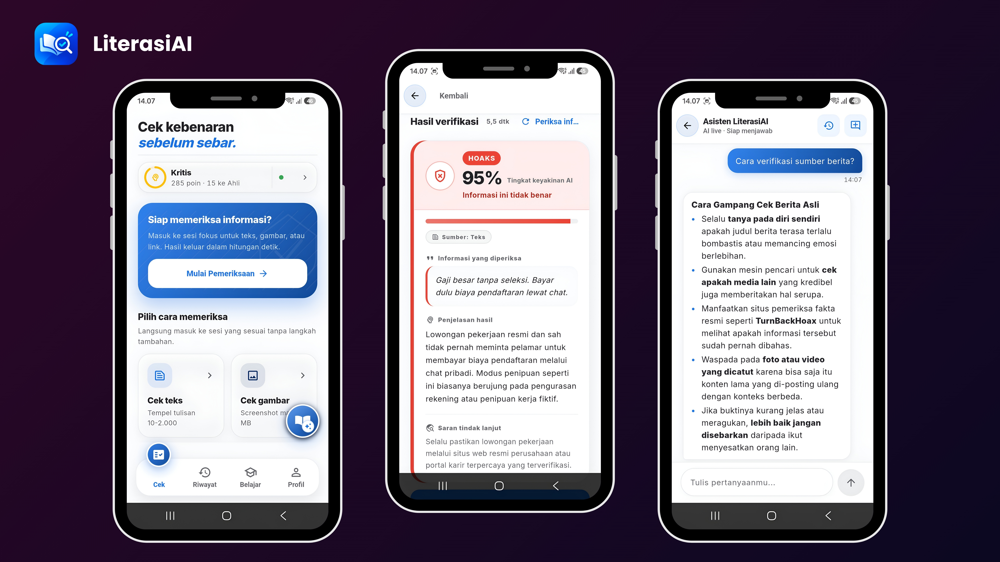

<div align="center">


# LiterasiAI

### Cek dulu sebelum sebar.

Aplikasi Android literasi digital yang membantu pengguna memeriksa klaim dari teks, gambar, dan tautan—serta memahami alasan dan langkah lanjutnya.

**Lihat pratinjau aplikasi di bawah tanpa perlu mengunduh APK.**

[](https://flutter.dev)
[](https://dart.dev)
[](https://firebase.google.com)
[](https://ai.google.dev)
[](#verifikasi-proyek)

</div>

<p align="center">
  
</p>

<p align="center"><sub>Cuplikan aplikasi: Cek · Hasil verifikasi · Asisten LiterasiAI</sub></p>

---

## Tentang proyek

LiterasiAI dirancang untuk membuat pemeriksaan informasi lebih mudah dijangkau. Pengguna dapat memulai pemeriksaan dari aplikasi atau membagikan teks, tautan, maupun gambar ke LiterasiAI dari aplikasi Android lain. Hasil menyajikan verdict, tingkat keyakinan, penjelasan, dan saran tindak lanjut.

> **Penting:** hasil AI adalah alat bantu, bukan penentu kebenaran atau pengganti pemeriksaan sumber primer. Periksa kembali informasi penting melalui sumber tepercaya sebelum mengambil keputusan atau menyebarkannya.

## Fitur

| Fitur | Yang dapat dilakukan |
| --- | --- |
| **Cek teks** | Periksa klaim berbahasa Indonesia dan lihat verdict `HOAKS`, `VALID`, `PERLU DICEK`, atau `TIDAK_DAPAT_DIPASTIKAN`, disertai penjelasan dan saran. |
| **Cek gambar** | Pilih gambar untuk dianalisis; pratinjau mendukung zoom, rotasi, dan berbagi lampiran. |
| **Cek tautan** | Ambil metadata halaman yang tersedia dan gunakan sebagai konteks pemeriksaan. |
| **Android Share Target** | Kirim teks, tautan, atau gambar dari menu **Bagikan** Android ke alur pemeriksaan LiterasiAI. Pengguna tetap meninjau dan memulai pemeriksaan. |
| **Asisten literasi** | Ajukan pertanyaan seputar kebiasaan memeriksa informasi dan teruskan percakapan ke Cek untuk ditinjau. |
| **Riwayat dan skor** | Simpan riwayat serta progres akun di Firestore; data cloud terkait akun hanya tersedia setelah autentikasi dan aturan Firestore dikonfigurasi. |
| **Belajar dan trending** | Pelajari modul literasi digital dengan kuis, dan jelajahi contoh informasi trending yang dikurasi di aplikasi. |
| **Mode demo dan BYOK** | Coba alur demo offline dengan label yang jelas, atau gunakan kunci Gemini sendiri untuk respons AI langsung. |

## Coba aplikasi

### APK Android

> LiterasiAI saat ini dibagikan sebagai **APK untuk instalasi manual**. Aplikasi ini **belum tersedia di Google Play Store**. Tautan unduhan APK perlu dibagikan terpisah oleh pemilik proyek; README ini tidak mengarahkan ke tautan unduhan yang belum dipastikan.

1. Unduh APK dari tautan distribusi yang diberikan pemilik proyek.
2. Buka file APK di perangkat Android dan izinkan pemasangan dari sumber tersebut bila diminta.
3. Buka LiterasiAI. Mode demo dapat digunakan untuk mencoba alur tanpa memasukkan kunci API.
4. Untuk hasil AI langsung, atur kunci Gemini milik sendiri melalui **Profil → Kunci API Gemini**.

**Catatan Google Sign-In:** SHA-1 dari signing certificate APK yang digunakan harus didaftarkan pada aplikasi Android di Firebase Console. Debug dan release dapat memakai sertifikat berbeda. Google Sign-In dapat gagal bila SHA-1 yang cocok belum didaftarkan. Fitur demo tidak memerlukan login atau kunci Gemini.

### Jalankan dari source

**Prasyarat:** Flutter 3.32 atau lebih baru (Dart 3.8+), Android SDK untuk target Android, konfigurasi Firebase proyek, serta kunci Gemini untuk mode live. Untuk mengaktifkan autentikasi/penyimpanan cloud, siapkan Firebase Auth dan Firestore; lihat [Konfigurasi layanan](#konfigurasi-layanan).

```bash
flutter pub get

# Jalankan dengan mode demo (tanpa kunci live)
flutter run

# Atau sediakan kunci Gemini hanya untuk proses run lokal
flutter run --dart-define=GEMINI_API_KEY=KUNCI_ANDA
```

> Jangan masukkan kunci API pribadi ke source control, tangkapan layar, atau log yang dibagikan. Untuk distribusi build, pertimbangkan alur penyimpanan kunci yang aman; `--dart-define` bukan mekanisme backend rahasia.

### Konfigurasi layanan

1. Hubungkan project Firebase menggunakan FlutterFire CLI (`flutterfire configure`).
2. Aktifkan metode autentikasi yang dipakai pada Firebase Authentication.
3. Deploy aturan `firestore.rules` ke Firestore sebelum mengandalkan penyimpanan riwayat dan skor akun.
4. Untuk Google Sign-In Android, daftarkan SHA-1 sertifikat signing yang sesuai di Firebase Console dan perbarui konfigurasi Android bila diperlukan.
5. Untuk respons Gemini langsung, masukkan kunci sendiri melalui **Profil → Kunci API Gemini**. Tanpa kunci valid, aplikasi menggunakan mode demo dan tidak mengirim permintaan AI.

Konfigurasi Firebase client seperti `google-services.json` dan `firebase_options.dart` mengidentifikasi aplikasi, tetapi bukan pengganti aturan keamanan Firestore. Akses data tetap harus dibatasi dengan rules yang sesuai.

## Cara kerja singkat

1. Pengguna memasukkan klaim, memilih gambar, membuka tautan, atau menerima konten lewat Android Share Target.
2. Pengguna meninjau konten lalu memulai pemeriksaan. Jika kunci Gemini tersedia, permintaan dikirim ke Gemini; tanpa kunci, jalur demo lokal menampilkan hasil demo yang ditandai.
3. Aplikasi menyajikan verdict, confidence, penjelasan, dan saran. Jika tersedia sesi pengguna dan Firestore terkonfigurasi, hasil dapat disimpan dalam riwayat akun.

Model AI dapat keliru, tidak selalu memiliki konteks terbaru, dan hasil tidak menjamin bahwa suatu klaim benar atau salah. Hindari mengirim informasi sensitif. Konten yang diperiksa pada mode live diproses oleh layanan Gemini sesuai pengaturan dan kebijakan layanan Google.

## Arsitektur

Proyek menggunakan struktur fitur dengan pemisahan **Presentation**, **Domain**, dan **Data**, serta Riverpod untuk state management.

```text
lib/
├── app/                  # shell aplikasi dan navigasi utama
├── core/                 # tema, konstanta, utilitas, dan error
├── features/
│   ├── auth/              # autentikasi dan onboarding
│   ├── quick_check/       # teks, gambar, URL, hasil, dan Share Target
│   ├── chat/              # asisten literasi
│   ├── history/           # riwayat pemeriksaan
│   ├── trending/          # konten trending terkurasi
│   ├── learn/              # modul dan kuis
│   └── score/              # progres, profil, dan pengaturan kunci
├── shared/                # widget yang digunakan lintas fitur
└── main.dart              # bootstrap dan ProviderScope

test/                      # unit, widget, dan regression tests
assets/                    # font, branding, dan media aplikasi
```

- **Domain:** entitas dan kontrak repository.
- **Data:** datasource Gemini/Firebase, pemetaan model, dan implementasi repository.
- **Presentation:** layar/widget Flutter dan provider Riverpod.

## Privasi dan batasan

- Mode demo berjalan tanpa permintaan ke Gemini, tetapi hasil demo bersifat ilustratif dan bukan verifikasi faktual.
- Mode live mengirim materi pemeriksaan ke Gemini untuk diproses. Jangan gunakan untuk data pribadi atau rahasia.
- Riwayat dan skor cloud bergantung pada autentikasi, koneksi, konfigurasi Firebase, serta Firestore rules. Progres lokal guest tidak otomatis digabung ke akun.
- **Belum ada offline queue** untuk mengantrekan permintaan live saat tidak ada koneksi. Mode demo offline bukan berarti analisis Gemini dapat berjalan tanpa internet.
- APK didistribusikan manual, bukan melalui Play Store. Ketersediaan tautan APK bergantung pada pemilik proyek.
- Pengujian otomatis dan build bukan pengganti uji penggunaan menyeluruh pada berbagai perangkat fisik. Kompatibilitas dan pengalaman perangkat tetap perlu divalidasi.
- Android Share Target telah diimplementasikan; perilaku penerimaan konten dapat berbeda menurut aplikasi pengirim dan jenis konten.

## Status pengembangan

**Sudah tersedia:** alur cek teks/gambar/tautan, tampilan hasil dan berbagi, Android Share Target, chat edukasi, riwayat dan skor Firebase, modul belajar, trending terkurasi, mode demo, serta penggunaan kunci Gemini milik pengguna.

**Belum menjadi bagian dari rilis ini / masih perlu validasi:** offline queue, pengalaman `Open with` Windows, split-view tablet, parity iOS, serta uji menyeluruh pada perangkat fisik. Jangan menganggap item tersebut sudah tersedia hanya karena tercantum sebagai kemungkinan pengembangan.

## Verifikasi proyek

Pemeriksaan dijalankan pada source tree saat README ini diperbarui:

| Perintah | Hasil |
| --- | --- |
| `flutter analyze` | Bersih — tidak ada issue. |
| `flutter test` | **459 test lulus**. |

Jalankan kembali dari root proyek:

```bash
flutter analyze
flutter test
```

## Struktur dokumentasi

- [`PRD.md`](PRD.md) — tujuan produk dan spesifikasi.
- [`progress.md`](progress.md) — catatan progres pengembangan.
- [`firestore.rules`](firestore.rules) — aturan akses Firestore yang harus ditinjau dan dideploy untuk proyek Firebase.

---

<p align="center"><sub>Dibuat sebagai proyek portofolio LiterasiAI · Indonesia</sub></p>
